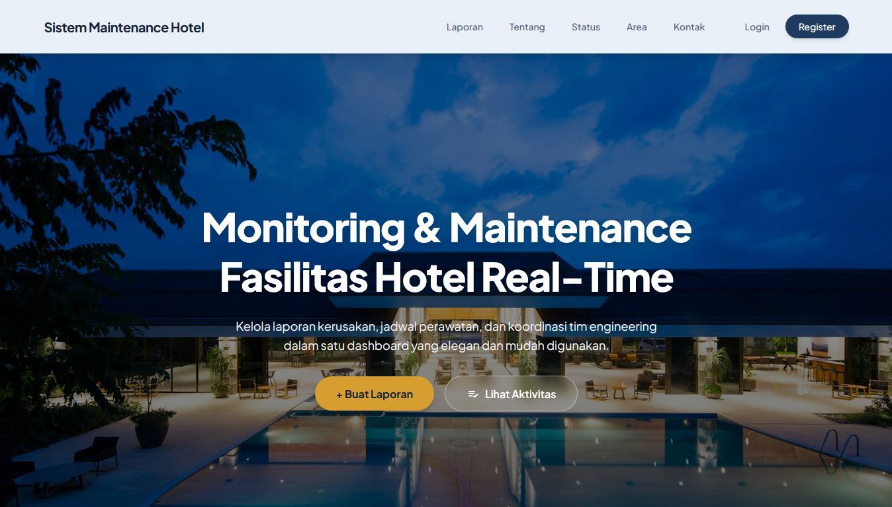
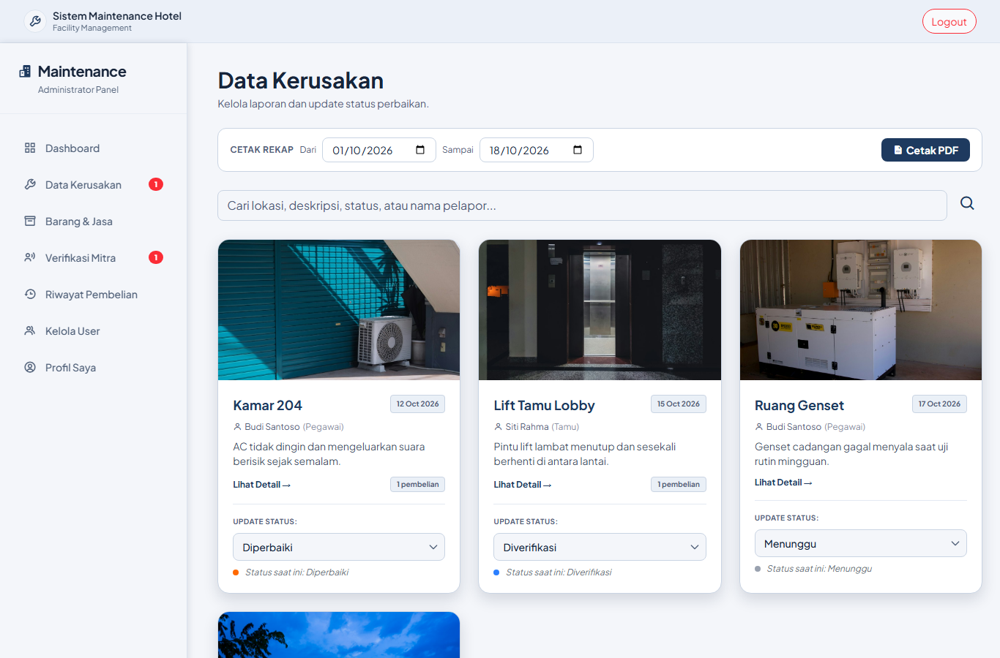
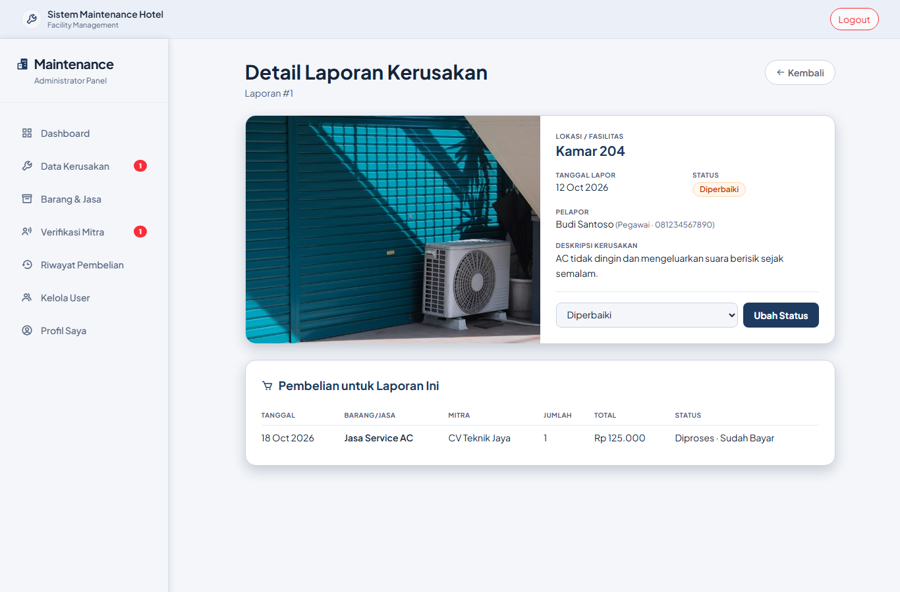
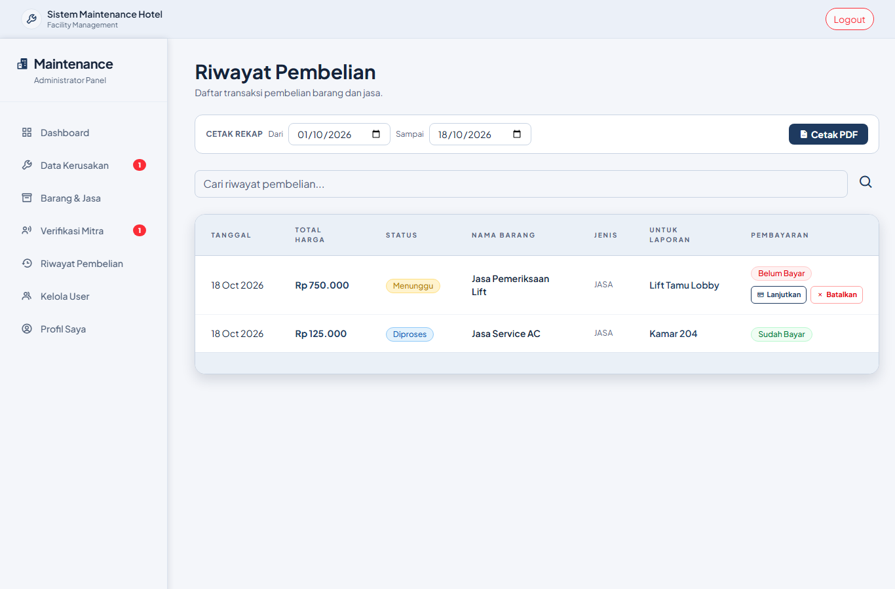
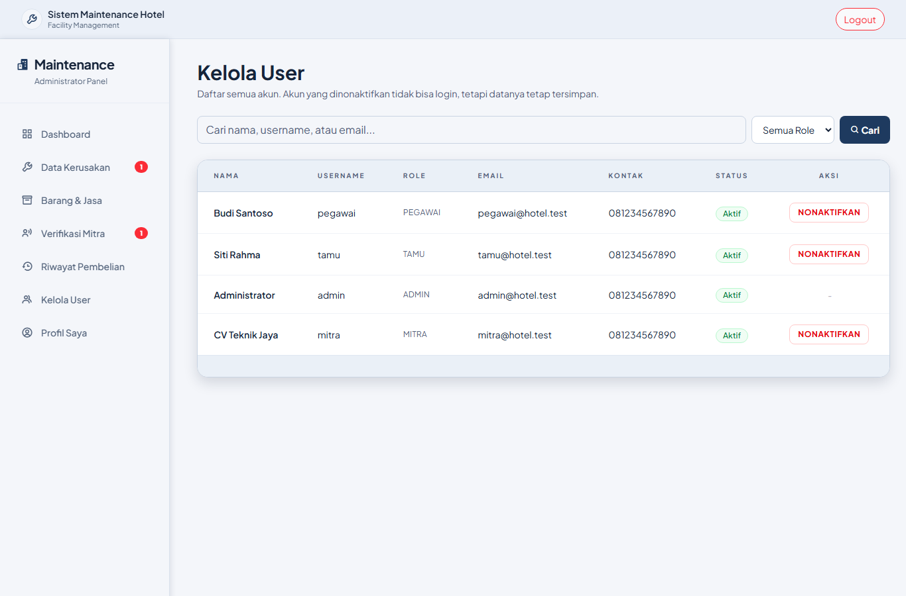
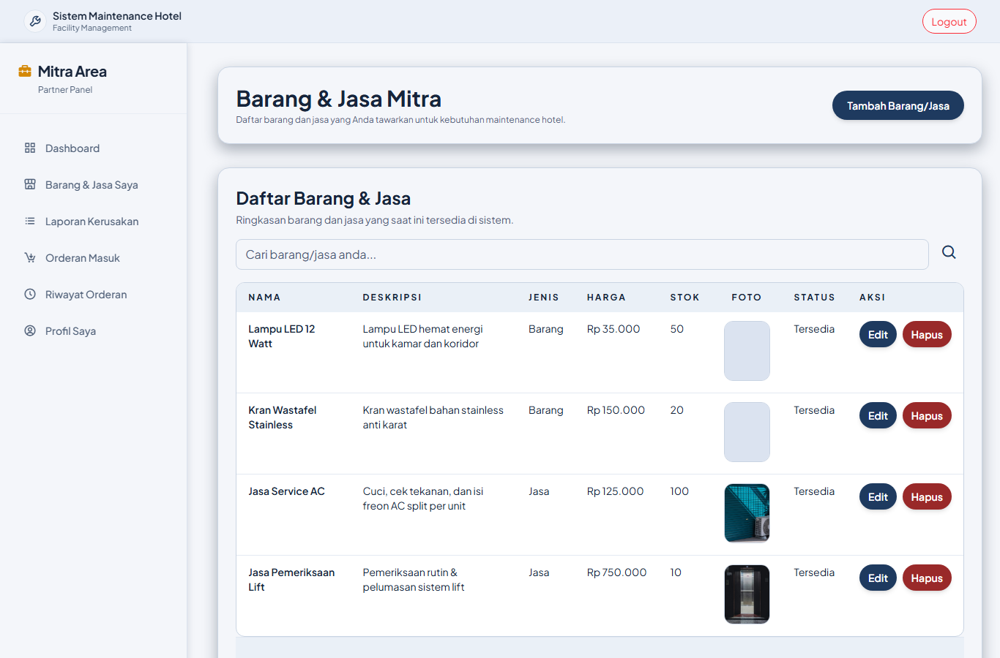
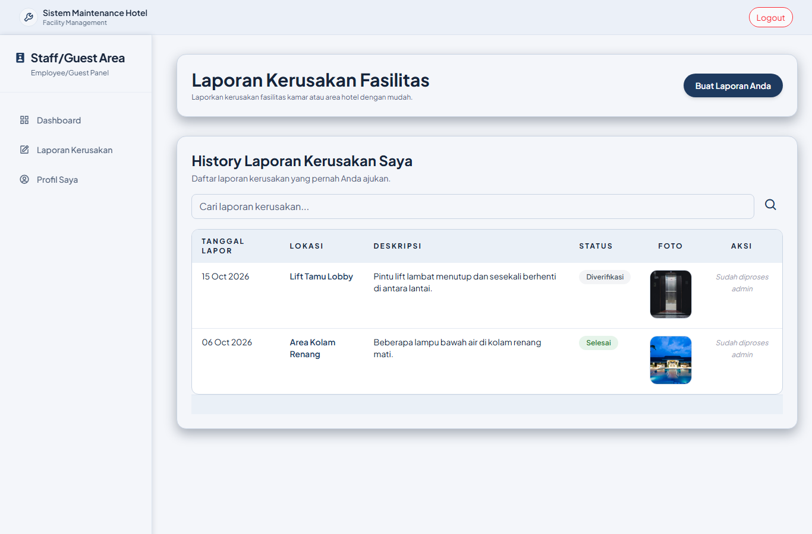

# Sistem Maintenance Hotel

Aplikasi web untuk mengelola **laporan kerusakan fasilitas hotel** dari awal sampai selesai: tamu/pegawai melapor, admin memverifikasi dan membeli barang/jasa perbaikan ke **mitra vendor**, lalu progres dipantau hingga laporan selesai dan direkap ke PDF.

Dibangun dengan **Laravel 10**, MySQL, dan Tailwind CSS.



## Fitur utama

**Tamu & Pegawai**
- Membuat laporan kerusakan lengkap dengan foto (dikompres otomatis)
- Mengubah atau menghapus laporan selama masih berstatus *Menunggu*
- Melihat riwayat dan detail laporan miliknya

**Admin**
- Dashboard ringkasan, badge notifikasi, dan email untuk laporan baru serta pendaftaran mitra
- Verifikasi laporan dan ubah status (*Menunggu → Diverifikasi → Diperbaiki → Selesai*)
- Membeli barang/jasa ke mitra **untuk laporan tertentu**. Saat bukti bayar diunggah, stok mitra berkurang, resi terbit, dan status laporan otomatis menjadi *Diperbaiki*
- Verifikasi pendaftaran mitra baru
- Kelola user: aktifkan/nonaktifkan akun
- Cetak rekap laporan dan pembelian ke **PDF** berdasarkan rentang tanggal

**Mitra (vendor)**
- Mengelola katalog barang/jasa beserta stok
- Memproses pesanan masuk dan mencetak resi PDF

**Semua role**: halaman profil untuk mengubah data diri dan password.

## Screenshot

| | |
|---|---|
|  **Admin: data kerusakan** |  **Admin: detail laporan & pembelian terkait** |
|  **Admin: riwayat pembelian & cetak rekap** |  **Admin: kelola user** |
|  **Mitra: katalog barang & jasa** |  **Tamu: riwayat laporan** |

Screenshot lainnya ada di [`docs/screenshots`](docs/screenshots).

## Catatan teknis

- **Hak akses per role** lewat middleware (`role:Admin`, `role:Mitra`, `role:Tamu,Pegawai`), ditambah pengecekan kepemilikan data sehingga user tidak bisa mengakses data milik user lain dengan mengganti ID di URL
- **Reset password** memakai token yang divalidasi dan hangus setelah dipakai, ditambah rate limiting pada login dan reset password
- **Transaksi database** pada proses multi-tabel (verifikasi mitra, pembayaran beserta pengurangan stok dan update status laporan)
- **Migration + seeder** untuk membuat database lengkap dengan data demo dalam satu perintah
- **52 feature test** (PHPUnit) yang mencakup autentikasi, hak akses, alur pembelian, profil, kelola user, dan rekap PDF

## Teknologi

| | |
|---|---|
| Backend | PHP 8.1+, Laravel 10 |
| Database | MySQL / MariaDB |
| Frontend | Blade, Tailwind CSS, Boxicons |
| PDF & gambar | barryvdh/laravel-dompdf, intervention/image |
| Testing | PHPUnit |

## Menjalankan di lokal

Kebutuhan: PHP 8.1+ (ekstensi `gd`, `pdo_mysql`), Composer, dan MySQL/MariaDB (misalnya XAMPP).

```bash
git clone <url-repo-ini>
cd <nama-folder>
composer install
cp .env.example .env
php artisan key:generate
php artisan storage:link
```

Buat database `maintenance_hotel` (atau sesuaikan `DB_*` di `.env`), lalu:

```bash
php artisan migrate --seed
php artisan serve
```

Buka http://127.0.0.1:8000.

### Akun demo

| Role | Username | Password |
|------|----------|----------|
| Admin | `admin` | `admin123` |
| Pegawai | `pegawai` | `pegawai123` |
| Tamu | `tamu` | `tamu123` |
| Mitra | `mitra` | `mitra123` |

### Email

Secara default `MAIL_MAILER=log`, jadi email (notifikasi, reset password, resi) tidak dikirim tetapi ditulis ke `storage/logs/laravel.log`. Untuk mengirim email sungguhan, isi pengaturan SMTP di `.env`. Contohnya ada di `.env.example`.

## Menjalankan test

Test memakai database terpisah `maintenance_hotel_test` (diatur di `phpunit.xml`) yang dikosongkan setiap kali test berjalan, sehingga data lokal tidak tersentuh.

```sql
CREATE DATABASE maintenance_hotel_test;
```

```bash
php artisan config:clear
php artisan test
```

## Kredit

Foto di landing page dan data demo berasal dari [Unsplash](https://unsplash.com) (Unsplash License).
